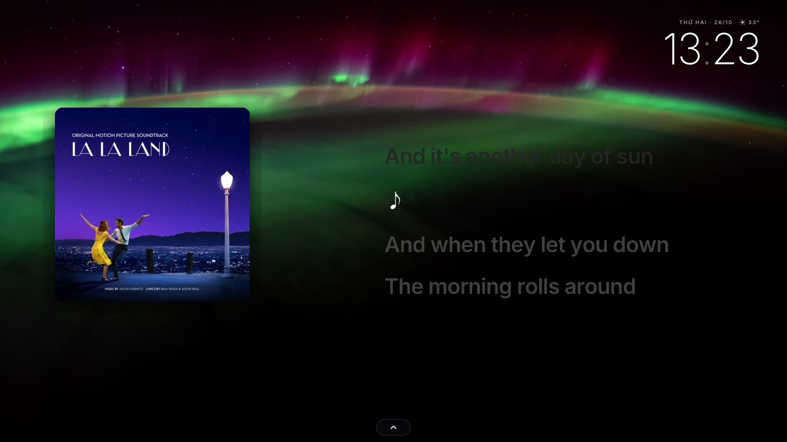
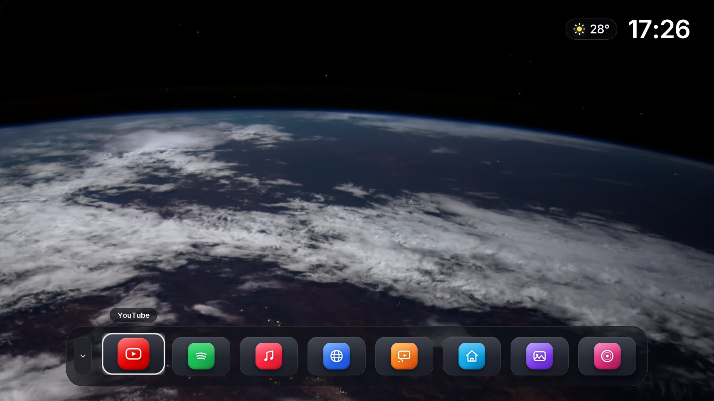

# Sonoma TV — tvOS Minimal Launcher cho LG Smart TV (webOS)

Dự án thay thế launcher mặc định trên Smart TV LG bằng giao diện tối giản phong cách Apple TV (tvOS), tích hợp trình phát nhạc AirPlay hiển thị lời bài hát đồng bộ (Synced Lyrics) và kho video nền 4K Apple Aerial.

---

## Showcase

### 1. Giao diện phát nhạc AirPlay
Bìa album sắc nét, tên bài hát và lời chạy chữ đồng bộ tự động nổi trên nền video 4K:


### 2. Giao diện Launcher chính & Thanh Dock ứng dụng
Thanh Dock kính tối bo cong, chứa các ứng dụng cài trên TV (YouTube, Spotify, Apple Music, Homebrew Channel...):


---

## ⚡ Các tính năng chính

### 1. Thay thế Launcher gốc & Khởi động tức thì (~0.05s)
- **Neo boot cấp hệ thống (`bootd.json`):** Cấu hình trực tiếp vào `/var/luna/preferences/bootd.json` để hệ thống webOS nhận diện Sonoma TV là ứng dụng khởi động mặc định.
- **Bỏ qua CoverUI:** Khắc phục triệt để lỗi treo màn hình đen hoặc banner chờ 30 giây của LG khi bật TV.
- **Mở máy tức thì:** Khi TV ở chế độ Standby (Quick Start+), bấm Remote là màn hình sáng lên và vào thẳng giao diện trong ~0.05 giây.
- **Bắt phím HOME trên Remote:**
  - Nhấn nhanh: Quay về Sonoma TV launcher.
  - Nhấn giữ 3 giây: Mở lại thanh Ribbon gốc của LG khi cần cài đặt hệ thống.
  - bạn cần kích hoạt tính năng quickstart trên tivi của mình để đạt được tốc độ nhanh nhất

### 2. Tuyển chọn 83 video nền 4K Apple Aerial
- Sử dụng cơ chế giải mã phần cứng **VPU Hole-Punching** của webOS: video chạy trực tiếp trên chip giải mã, không tốn tài nguyên CPU/GPU của giao diện.
- Stream trực tiếp qua mạng LAN, không tốn bộ nhớ flash eMMC của TV.

### 3. Bộ thu AirPlay (Sonoma TV) & Đồng bộ lời bài hát
- Tích hợp trình thu âm thanh AirPlay không nén (Shairport-Sync) đặt tên là **Sonoma TV**.
- **Đã tối ưu hóa toàn diện & khắc phục triệt để lỗi đứt quãng / mất tiếng:**
  - Chuyển sang `basic interpolation` thay vì `soxr` DSP nặng nề, giảm tải cho chip ARM Cortex-A53.
  - Cấu hình ngưỡng `resync_threshold_in_seconds = 0.500s` (thay vì 0.050s) và `drift_tolerance = 0.008s`: ngăn Shairport-Sync xả sạch buffer và gây ngắt tiếng đột ngột khi Wi-Fi có jitter.
  - Mở rộng bộ đệm ALSA lên `0.35s` (`audio_backend_buffer_desired_length_in_seconds`) giúp âm thanh mượt mà.
  - Bật `disable_standby_mode = "always"` giữ DAC âm thanh luôn mở, chống hiện tượng nấc cụt hoặc mất tiếng đầu bài.
  - Cấp quyền ưu tiên tiến trình thời gian thực (`chrt -f 45` / `nice -n -19`): giải mã âm thanh không bao giờ bị tranh chấp CPU bởi Chromium hay chip VPU.
  - Thêm `pipe_timeout = 5000ms` và nâng đệm FIFO lên 4MB: chống treo/nghẽn luồng khi truyền tải ảnh bìa kích thước lớn từ Apple Music.
  - Thuật toán bù trôi mượt (smooth nudge) cho lời bài hát đồng bộ: chuyển câu mượt mà, không giật nhảy vị trí.
- Tự động hiển thị bìa album, tên bài hát và lời bài hát chạy chữ từng câu chuẩn phong cách Apple Music.

### 4. Tinh chỉnh hệ thống & Debloat (10-debloat)
TV LG chạy mượt hơn nhờ dọn dẹp các service chạy ngầm không cần thiết:
- **Tắt AirPlay & HomeKit mặc định của LG:** Ngăn chặn xung đột và hiện tượng trùng lặp 2 luồng AirPlay trên iPhone/Mac.
- **Dừng các service theo dõi & quảng cáo của LG:** `uploadd`, `rdxd`, `admanager`, `contentminer`, `crashreportd`, `webos-preload-manager`...
- **Tối ưu Linux Kernel (`sysctl`):**
  - `vm.swappiness=15`: Giữ RAM vật lý cho app, hạn chế ghi swap ra bộ nhớ flash eMMC giúp tăng tuổi thọ chip nhớ.
  - `net.core.rmem_max=8388608` & `netdev_max_backlog=5000`: Mở rộng hàng đợi và bộ đệm mạng cho video 4K bitrate cao và gói tin UDP AirPlay.

---

## 🛠️ Yêu cầu thiết bị

- Smart TV LG đã Root (có **Homebrew Channel** và SSH Port 22).
- Đã kiểm nghiệm hoàn hảo trên **LG 49SM8100PTA** (webOS 4.5 / Linux 4.4.84 armv7l).

---

## 🚀 Hướng dẫn cài đặt (Deploy)

1. Clone repository về máy tính:
   ```bash
   git clone https://github.com/Atelier07/sonoma-tv.git
   cd sonoma-tv
   ```
2. Mở file `scripts/deploy.sh`, điền địa chỉ IP của TV:
   ```bash
   TV_IP="192.168.1.x"
   ```
3. Chạy lệnh cài đặt 1-click:
   ```bash
   ./scripts/deploy.sh
   ```
Script sẽ tự động đẩy toàn bộ file giao diện, cấu hình khởi động `bootd.json`, bộ thu AirPlay và các daemon tối ưu lên TV.

---

## 🎮 Phím tắt điều khiển Remote

| Phím | Chức năng |
| :--- | :--- |
| **Bất kỳ phím nào** | Đánh thức thanh Dock trượt lên (tự ẩn sau 5 giây không bấm) |
| **D-pad Trái / Phải** | Di chuyển giữa các ứng dụng trên Dock |
| **OK / Enter** | Mở ứng dụng |
| **D-pad Lên** | Ẩn thanh Dock ngay lập tức để ngắm trọn video |
| **HOME (bấm nhanh)** | Quay về màn hình chính Sonoma TV |
| **HOME (giữ 3 giây)** | Mở thanh Home gốc của LG |
