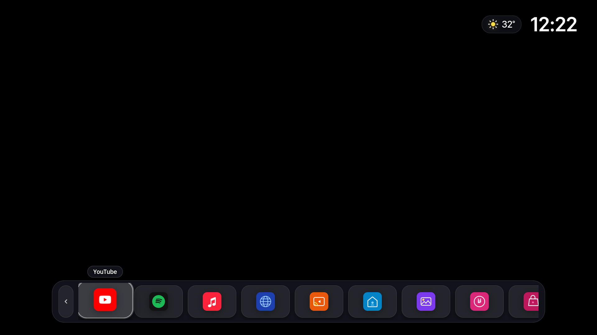

# Apple TV (tvOS) Minimal Launcher for LG webOS Smart TV

Giao diện khởi chạy phong cách Apple TV (tvOS) tối giản, siêu mượt dành cho Smart TV LG (webOS 4.5 / NanoCell 4K). Tích hợp video nền 4K chạy trực tiếp trên tầng phần cứng VPU, đồng hồ cỡ lớn, thời tiết thời gian thực và thanh Dock chứa 10 ứng dụng thật trên TV (bao gồm kho ứng dụng Root **Homebrew Channel**).



---

## 📺 Thông số thiết bị mục tiêu

- **Model:** LG 49SM8100PTA (NanoCell 4K, 49 inch)
- **Hệ điều hành:** LG webOS 4.10.0 (webOS 4.5)
- **Kernel:** Linux `armv7l` (Linux 4.4.84)
- **Trình duyệt Web:** Chromium 53 (Chrome 53.0.2785.34)
- **IP cục bộ:** `192.168.1.6`
- **Tình trạng:** **ĐÃ ROOT VĨNH VIỄN (`uid=0`, `root`)**

---

## ⚡ Tính năng nổi bật

1. **Video nền 4K xoay vòng (Apple Aerial):**
   - Sử dụng cơ chế **Hardware Overlay Plane (VPU Hole-Punching)** của webOS. Video giải mã độc lập bằng chip phần cứng, hoàn toàn không tốn CPU hay GPU của giao diện.
   - **Toàn bộ 114 clip 4K HEVC SDR chính chủ Apple** (`url-4K-SDR`, giải mã bằng VPU) — phát hết đoạn này thì tự đổi sang đoạn khác, xáo trộn ngẫu nhiên, lặp vô hạn. Nguồn: `src/aerials.json` (sinh bằng `scripts/fetch_aerials.py`).
   - **Stream trực tiếp qua mạng LAN, không ghi vào ROM.** **Chuyển cảnh liền mạch, không cắt đen**: dùng **2 tầng video** — tầng đang chiếu và tầng ngầm. Ngay khi clip hiện tại bắt đầu phát, tầng ngầm nạp trước clip kế ở chế độ **chỉ đọc metadata (`preload="metadata"`)** nên **không cướp decoder** của tầng đang chiếu; tới lúc gần hết, tầng ngầm (đã đủ dữ liệu) **tiếp quản tức thì**.
   - **Chống màn hình đen:** lớp dip chỉ còn dùng khi cần buffer lại (khởi động nguội / lỗi mạng), không dùng cho chuyển clip thường. Và lớp dip không phải `#000` — đây là **nền Aerial động vẽ bằng CSS** (dải aurora xanh-teal trôi chậm trên gradient đêm, chỉ animate `transform`/`opacity` nên không tốn decoder). Vì VPU chỉ giải mã **1 video tại một lúc**, nền CSS này che khoảng **~2–4s** lúc nạp clip 4K đầu tiên và cả lúc cold start sau khi mở app khác.
   - **Fallback offline:** mất mạng → tự rơi về clip **Dubai nhúng sẵn**; clip lỗi → tự nhảy sang clip kế.
2. **Giao diện Apple TV — Icon màu trên ô kính tối:**
   - Thẻ ứng dụng dạng ngang tỉ lệ 3:2 bo cong mềm mại (`156px x 104px`, `border-radius: 26px`), cách nhau `26px`.
   - Mỗi ô là một khối kính tối (gradient xám đậm + viền sáng + sheen), ở giữa đặt một **icon ứng dụng màu bo vuông** (`--icon-bg` gradient thương hiệu + glyph SVG trắng) — đúng phong cách tvOS, nhìn sang và "đắt tiền".
   - **Dock mặc định ẩn** cho ngắm trọn video nền; chạm *bất kỳ* nút nào trên remote là Dock trượt lên, tự ẩn lại sau ~5 giây không bấm.
3. **100% App thật từ TV:**
   - Lấy trực tiếp từ hệ thống: *YouTube, Spotify, Apple Music, Trình duyệt web, Web Video Caster, Bảng điều khiển nhà, Ảnh & Video, Âm nhạc, LG Content Store, Homebrew Channel*.
4. **Hiệu năng 60fps tuyệt đối:**
   - Đã loại bỏ các hiệu ứng gây nghẽn GPU như `backdrop-filter: blur()`.
   - Cuộn Dock bằng `translate3d` trên GPU và vị trí focus tính bằng toán học thuần túy $O(1)$ (cache layout một lần), triệt tiêu Layout Thrashing. Focus chỉ animate `transform`/`opacity`.
5. **Đồng hồ & Thời tiết cỡ lớn:**
   - Đồng hồ 68px Bold rõ nét, nhiệt độ thời tiết cập nhật trực tiếp từ Open-Meteo API, dễ đọc từ khoảng cách ghế sofa 3m.

---

## 🎮 Hướng dẫn điều khiển (Remote Control)

| Phím bấm | Chức năng |
| :--- | :--- |
| **Bất kỳ nút nào trên remote** | Đánh thức Dock trượt lên (Dock mặc định ẩn; tự ẩn lại sau ~5s không bấm) |
| **Trái / Phải (D-pad Left/Right)** | Di chuyển mượt mà giữa các ứng dụng trên Dock |
| **OK / Enter** | Mở ứng dụng tương ứng ngay lập tức qua webOS Service Bridge |
| **Lên (D-pad Up) / Nút thu gọn (mũi tên xuống)** | Ẩn thanh Dock xuống đáy màn hình để ngắm trọn video 4K |
| **Tab mũi tên lên ở đáy** | Chạm để mở lại Dock khi đang ẩn |
| **HOME (nhấn nhanh)** | Quay về launcher Aerial (thay vì Home gốc) — xem mục *Chiếm quyền nút Home* |
| **HOME (giữ ≥ 5 giây)** | Về Home gốc của webOS |

---

## ⌂ Chiếm quyền nút Home & Neo Khởi động Tức thì (~0.05s)

- **Neo Boot cấp hệ thống (`config/bootd.json`):**
  - Hệ thống sử dụng file `/var/luna/preferences/bootd.json` để cấu hình bộ quản lý khởi động chính thức `/usr/sbin/bootd` của webOS.
  - Ánh xạ trực tiếp Launcher vào danh mục `inputApps` và đặt `remoteKey: "{LAST_APP}"`.
  - Giúp TV **bỏ qua hoàn toàn CoverUI**, không bị màn hình chờ 30 giây, bật TV từ Standby là sáng màn hình và vào thẳng Launcher trong **0.05 giây**.
- **Cơ chế Wake-up mượt mà (`appinfo.json` & `src/index.html`):**
  - Cấu hình `"handlesRelaunch": false` cùng bộ lắng nghe `webOSRelaunch` và `visibilitychange` tự động gọi `PalmSystem.activate()`, triệt tiêu hoàn toàn hiện tượng đen màn hình khi TV thức giấc.
- **`scripts/aerial-daemon.js`** — Daemon chạy nền duy nhất:
  - Bắt trực tiếp `/dev/input/event*` phím **HOME (773)**:
    - **Nhấn nhanh:** Đưa Apple TV Launcher trở lại tiền cảnh.
    - **Giữ ≥ 3 giây:** Mở Launcher gốc của webOS (`com.webos.app.home`).
  - Tích hợp HTTP bridge đồng bộ lời bài hát AirPlay trên cổng 8899.
- **`scripts/20-aerial-launcher`** — init.d tự động đưa Launcher lên tiền cảnh trong các tình huống khởi động nguội (cold boot).
- **`scripts/10-debloat`** — Tối ưu bộ nhớ RAM, Swappiness, bộ đệm stream 4K và chặn sạch quảng cáo / telemetry của LG.

---

## 🛠️ Cấu trúc thư mục dự án

```text
webos-tvos-launcher/
├── README.md                 # Tài liệu tổng quan
├── CONTEXT_HANDOVER.md       # Báo cáo bảo lưu context & nhật ký kỹ thuật
├── DEEPSEEK_GUIDE.md         # Bản hướng dẫn toàn diện cho AI
├── appinfo.json              # webOS App Manifest (QuickStart, NoSplash)
├── src/
│   ├── index.html            # Giao diện chính (HTML5/CSS/JS, PalmSystem.activate)
│   ├── aerials.json          # Catalog 114 clip Apple Aerial 4K HEVC
│   └── fonts/                # Bộ font Museo, Inter, Cormorant
├── scripts/
│   ├── fetch_aerials.py      # Tải manifest Apple → sinh src/aerials.json
│   ├── build.py              # Script dựng và tối ưu HTML (nhúng AERIALS inline)
│   ├── deploy.sh             # Script 1-click đẩy code, config, daemon lên TV
│   ├── reload_cdp.py         # Nạp lại trang và chụp ảnh màn hình TV (port 9998)
│   ├── test_remote.py        # Giả lập phím điều khiển từ xa qua WebSocket
│   ├── aerial-daemon.js      # Daemon bắt nút HOME, quản lý nguồn và AirPlay
│   ├── 10-debloat            # Tinh chỉnh hiệu năng RAM, mạng, chặn ads LG
│   └── 20-aerial-launcher    # Tự mở Launcher lúc cold boot
├── config/
│   ├── bootd.json            # File neo boot chính thức của bootd LG TV
│   ├── tv_specs.json         # Thông số kết nối TV, IP, Port, SSH key, Root status
│   └── tv_real_apps.json     # Danh mục launch points của TV
└── docs/
    ├── plans/                # Kế hoạch kỹ thuật & giải pháp chi tiết
    ├── root_and_security.md  # Chi tiết giải pháp Root và chống xóa app
    ├── audio_lyrics_roadmap.md # Kế hoạch làm Spotify Connect & Synced Lyrics
    └── screenshots/          # Hình ảnh thực tế TV
```

---

## 🚀 Cách triển khai (Deployment)

Chạy lệnh deploy 1-click lên TV qua SSH Root:
```bash
./scripts/deploy.sh
```

Kiểm tra hoặc chụp ảnh màn hình TV từ xa:
```bash
python3 ./scripts/reload_cdp.py
```

Giả lập phím bấm Remote từ máy tính:
```bash
python3 ./scripts/test_remote.py right
python3 ./scripts/test_remote.py left
python3 ./scripts/test_remote.py up
python3 ./scripts/test_remote.py down
python3 ./scripts/test_remote.py enter
```
